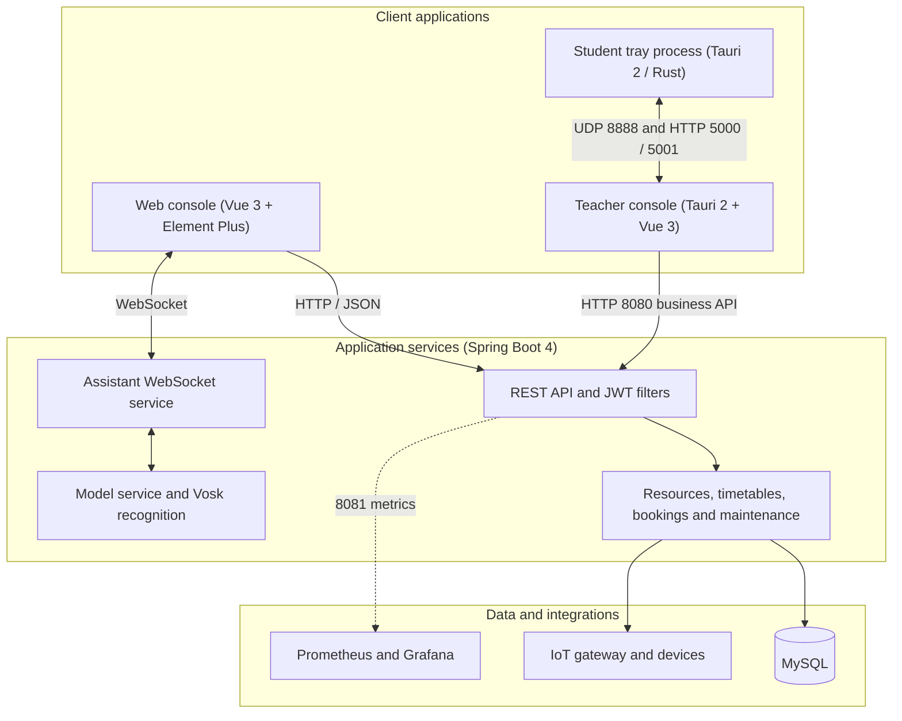
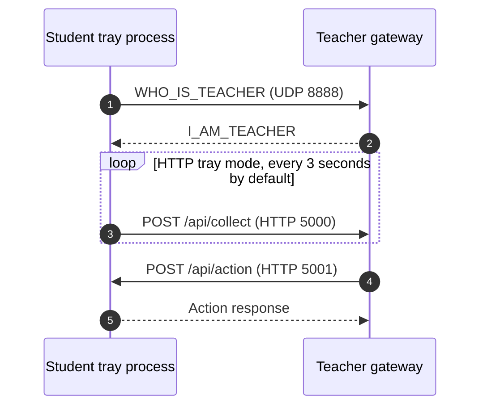
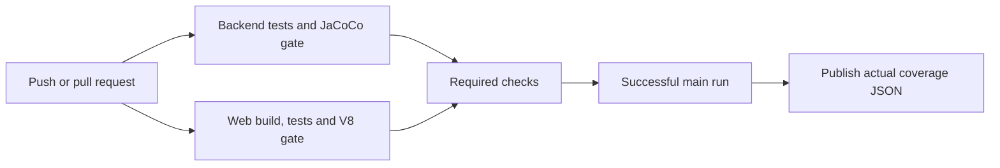

<div align="center">
  
  <h1>Zhiyun Laboratory</h1>
  <p>A laboratory operations platform for resources, scheduling, equipment and IoT integration.</p>
  <p><a href="README.md">中文</a> | <b>English</b></p>
  <p>
    <a href="https://github.com/Alexander-Noah/classjob/actions/workflows/ci.yml?query=branch%3Amain"></a>
    <a href="https://github.com/Alexander-Noah/classjob/actions/workflows/ci.yml?query=branch%3Amain"></a>
    <a href="https://app.codecov.io/github/Alexander-Noah/classjob"></a>
    
    
    
  </p>
</div>

## Contents

- [Features](#features)
- [Architecture](#architecture)
- [Technology stack](#technology-stack)
- [Repository layout](#repository-layout)
- [Requirements](#requirements)
- [Getting started](#getting-started)
- [Connecting clients to the API](#connecting-clients-to-the-api)
- [Desktop clients and device control](#desktop-clients-and-device-control)
- [AI and offline speech recognition](#ai-and-offline-speech-recognition)
- [Backend development](#backend-development)
- [Tests and security controls](#tests-and-security-controls)
- [HTTP and WebSocket interfaces](#http-and-websocket-interfaces)
- [Configuration](#configuration)
- [Deployment and monitoring](#deployment-and-monitoring)
- [CI and the coverage badge](#ci-and-the-coverage-badge)
- [Documentation](#documentation)

## Features

- **Resources and equipment:** laboratory records, equipment imports, asset QR codes, transfers, inventory checks, consumable stock and low-stock alerts.
- **Scheduling and reservations:** timetable collection/import, availability and conflict checks, reservation applications, public QR booking and approval workflows. Teacher-facing pages remain in the source, but the teacher role is currently disabled by the backend.
- **Course environments:** software requirements, preparation status and reusable environment records. These records do not imply that arbitrary software deployment has been verified.
- **Maintenance and notices:** repair records, status tracking, maintenance history and notifications. The maintenance login role is currently disabled.
- **IoT integration:** gateways, sensors, device state and commands for supported hardware. Physical integration requires the corresponding gateway configuration and equipment.
- **Desktop monitoring:** a Tauri teacher console and student tray processes for LAN discovery, telemetry and supported device actions.
- **AI and speech:** model-service integration, assistant conversations, WebSocket text/audio transport and local Vosk recognition.
- **Statistics:** ECharts dashboards for resource usage and operational records.

## Architecture



Typical workflow: import teaching schedules, prepare course environments, process reservations, track equipment and repairs, then review operational statistics. Available actions depend on the current role and configured integrations.

## Technology stack

| Area | Implementation |
| --- | --- |
| Backend | Java 17, Spring Boot 4.0.6, Spring Web MVC, MyBatis, HikariCP |
| Database | MySQL 8; CI uses MySQL 8.4 |
| Authentication | JWT, PBKDF2 password hashes, servlet filters, image CAPTCHA |
| Web | Vue 3, Vite, Element Plus, CSS Variables, ECharts |
| Desktop | Tauri 2, Rust, Vue and Naive UI |
| AI / speech | DashScope-compatible model service and Vosk |
| Timetable tools | Python collection and import scripts |
| Monitoring | Actuator, Prometheus, Grafana, Docker Compose |
| Tests | JUnit / Mockito / JaCoCo, Node tests, Vitest / V8 coverage |

Dependency versions are maintained in [Backend/pom.xml](Backend/pom.xml), [web/package.json](web/package.json) and the desktop manifests and lockfiles.

## Repository layout

```text
classjob/
├── .github/                     # CI and coverage-report scripts
├── Backend/                     # Java backend, SQL, Python helpers
│   ├── src/main/java/           # Controllers, services, mappers and security
│   ├── src/main/resources/      # Application settings and mapper XML
│   ├── database/                # Schema, migrations and recovery tools
│   └── start-local.ps1          # Local development launcher
├── web/                         # Vue management application
├── TvTa-ui-main/                # Teacher UI and shared desktop implementation
├── zhiyun-student-client/       # Separate student client project
├── shared/                      # Shared input and URL validation
├── Python/                      # Additional timetable utilities
├── vosk-model-small-cn-0.22/     # Local speech-model directory
├── monitoring/                  # Prometheus / Grafana configuration
├── docs/                        # Design documents, diagrams and reports
├── scripts/                     # Diagram generation tools
├── README.md                    # Chinese documentation
└── README.en.md                 # English documentation
```

## Requirements

| Tool | Requirement / use |
| --- | --- |
| Java | JDK 17, used by backend CI |
| Node.js | Node 24 recommended; the Web manifest requires at least 20.19 |
| Package manager | npm for Web; pnpm 10.30.3 for the desktop project |
| MySQL | MySQL 8; 8.4 is used in CI |
| Rust | A stable toolchain compatible with the current Tauri dependencies, only for desktop builds |
| Python | Python 3.10+ and the dependencies needed by the selected timetable scripts |
| Docker | Optional, for monitoring and isolated services |
| PowerShell | Required for the supplied Windows launch scripts |

## Getting started

### 1. Clone

```bash
git clone https://github.com/Alexander-Noah/classjob.git
cd classjob
```

### 2. Prepare a database

Create an empty database:

```sql
CREATE DATABASE IF NOT EXISTS smart_lab_basic
  DEFAULT CHARACTER SET utf8mb4 COLLATE utf8mb4_unicode_ci;
```

Import [the core schema](Backend/database/smart_lab_basic.sql) into that empty database. It contains table definitions, not business records, roles or users. It includes `DROP TABLE` statements: do not import it over an existing business database.

A fresh environment also needs initialized roles and an administrator with an independently chosen password. There is no universal demo account/password. Review [database recovery instructions](Backend/database/recovery/README.md) before using historical recovery scripts or migrations; recovery accounts are not production initialization credentials.

### 3. Start the backend

From the repository root, in PowerShell:

```powershell
cd Backend
$env:SMART_LAB_DB_USERNAME = "your-database-user"
$env:SMART_LAB_DB_PASSWORD = "your-database-password"
./start-local.ps1
```

The script generates local JWT and academic-credential secrets in a Git-ignored configuration file. Set `SMART_LAB_DB_URL` if your database is not at the default local address. Supply production configuration separately.

The business API listens on `http://127.0.0.1:8080`. Management endpoints use port `8081`; health is `/actuator/health` on that management port.

### 4. Start Web

Open another terminal at the repository root:

```bash
cd web
npm ci
npm run dev
```

Open the URL printed by Vite, normally `http://127.0.0.1:5173`. Vite may select another port if 5173 is occupied.

### 5. Sign in

Use a valid account in your initialized database. Active management roles are `systemAdmin`, `labAdmin` and `academic`; `teacher` and `maintenance` are disabled. Do not rely on old demo usernames or shared passwords.

Web login requires an image CAPTCHA. Click the image to refresh it. A challenge expires after five minutes and is consumed by a verification attempt. CAPTCHA storage is local to one backend JVM; multi-instance deployments need shared storage or session affinity.

## Connecting clients to the API

Web requests normally use the `/api` prefix. [Vite configuration](web/vite.config.js) loads `VITE_API_PROXY_TARGET` through `loadEnv` and proxies requests to `http://127.0.0.1:8080` by default, removing the `/api` prefix.

For another backend, set this in a local Web environment file:

```dotenv
VITE_API_PROXY_TARGET=http://your-backend-host:8080
```

Restart Vite after changing its environment. `VITE_API_BASE_URL` can instead select a direct API origin; configure backend CORS for that origin. Production static files require an actual server/proxy; Vite development settings are not a production proxy.

## Desktop clients and device control

The HTTP tray mode uses the following default ports:

| Component | Port | Purpose |
| --- | --- | --- |
| Teacher | UDP 8888 | Respond to `WHO_IS_TEACHER` discovery with `I_AM_TEACHER` |
| Teacher | HTTP 5000 | Receive student telemetry at `/api/collect` |
| Student | HTTP 5001 | Accept supported device commands at `/api/action` |
| Teacher | WebSocket 8765 | Alternative LAN WebSocket mode; a different protocol from HTTP tray mode |



Supported HTTP actions are `refresh`, `message`, `lock`, `reboot` and `shutdown`. These can affect real devices; use the mode and network configuration documented for your deployment.

For teacher development:

```bash
cd TvTa-ui-main
pnpm install --frozen-lockfile
pnpm tauri dev
```

To build the shared project's student binary, run `pnpm build:student` in that directory, then use `src-tauri/target/release/zhiyun-student-client.exe`. See [the separate student project](zhiyun-student-client/README.md) for its build and configuration. Source availability does not mean desktop packaging has been validated in the current environment.

## AI and offline speech recognition

### Model service

Inject a real key through `DASHSCOPE_API_KEY` rather than committing it. The backend uses this configuration hierarchy:

```yaml
tongyi:
  agent:
    enabled: true
    api-key: ${DASHSCOPE_API_KEY:}
    model: qwen-plus
```

`TONGYI_API_KEY` is also supported as a fallback. Per-user assistant settings may select a different compatible provider. Model answers require the configured remote service.

### Vosk

The default model path is `../vosk-model-small-cn-0.22/vosk-model-small-cn-0.22`, relative to the backend working directory. Override it with `VOSK_MODEL_PATH` when needed. The directory must contain an installed Vosk model.

The frontend captures audio and sends binary audio chunks over WebSocket. Vosk speech recognition can run offline; model-service conversations do not thereby become offline. Browser microphone access requires an appropriate secure context and permission.

### WebSocket

The backend assistant endpoint is `/ws/ai-assistant` (local direct URL: `ws://127.0.0.1:8080/ws/ai-assistant`). Use `wss://` behind HTTPS and the application's configured authentication protocol. The channel carries supported JSON messages and audio frames.

## Backend development

```text
Controller → Service / ServiceImpl → MyBatis Mapper / XML → MySQL
```

- Ordinary business JSON responses use the non-generic `Result` class. File downloads, proxies and streaming endpoints use their corresponding HTTP response types.
- `map-underscore-to-camel-case` maps database names such as `device_code` to Java fields such as `deviceCode`.
- Multi-record business updates use service transactions where appropriate.
- `RequestLoggingFilter` sets a request ID and records request information. Do not put credentials into logs.

See [backend development documentation](Backend/README.md) for detailed module conventions.

## Tests and security controls

### Backend

```bash
cd Backend
mvn -Pcoverage verify
```

The report is written to `Backend/target/site/jacoco/index.html`. The default local command does not enable optional MySQL integration suites. CI enables both `reservation.mysql.it` and `core.schema.mysql.it`, using an isolated MySQL service; see [the exact arguments](.github/workflows/ci.yml).

### Web

From a separate terminal at the repository root:

```bash
cd web
npm ci
npm test
npm run build
npm run test:coverage
```

Coverage reports are in `web/coverage/`. Both modules enforce at least **96% source-line coverage**, not a 96% test pass rate.

### Security boundaries

- AI message formatting creates controlled Vue nodes; untrusted HTML remains text. Dynamic print content is escaped, image URLs are checked and CSP limits active content.
- Shared frontend and backend checks reject invalid types, lengths, ranges and request structures. SQL parameter binding and authorization remain separate requirements.
- See [input rules](docs/输入校验规则与验证说明.md), [XSS changes](docs/HTML注入与XSS修复说明.md) and [security review](docs/项目安全审查-2026-10-19.md). These reports are in Chinese. A passing test or coverage check does not certify that every security risk has been resolved.

## HTTP and WebSocket interfaces

Protected HTTP endpoints require:

```http
Authorization: Bearer <your_jwt_token>
```

Anonymous login, CAPTCHA, public QR booking and other exceptions follow the backend allowlist. A typical successful JSON response is:

```json
{
  "code": 200,
  "message": "Operation successful",
  "data": []
}
```

Check the business response code as well as the HTTP status. The assistant WebSocket endpoint is `/ws/ai-assistant`; its text/audio protocol is separate from ordinary REST responses.

## Configuration

| Variable | Meaning / default |
| --- | --- |
| `SMART_LAB_DB_URL` | Database URL; the local launcher defaults to `jdbc:mysql://localhost:3306/smart_lab_basic` |
| `SMART_LAB_DB_USERNAME` | Database user; local launcher defaults to `root` |
| `SMART_LAB_DB_PASSWORD` | Your database password; set explicitly |
| `SMART_LAB_JWT_SECRET` | No shared production default; the local launcher can generate it |
| `ACADEMIC_CREDENTIAL_SECRET` | Secret for stored academic credentials; generated for local use by the launcher |
| `DASHSCOPE_API_KEY` | Model-provider key; empty unless supplied |
| `VOSK_MODEL_PATH` | Installed Vosk model directory |
| `VITE_API_MODE` | `server` for backend calls; mock mode is for development |
| `VITE_API_BASE_URL` | Web API prefix or origin; `/api` by default |
| `VITE_API_PROXY_TARGET` | Development proxy destination; `http://127.0.0.1:8080` by default |
| `SMART_LAB_OPENAPI_ENABLED` | `false`; enable explicitly for local API docs |
| `SMART_LAB_SWAGGER_UI_ENABLED` | `false`; enable explicitly for local Swagger UI |
| `GRAFANA_ADMIN_PASSWORD` | Set in the monitoring environment file |

Consult [application.yaml](Backend/src/main/resources/application.yaml), [the local profile](Backend/src/main/resources/application-local.yaml) and [Web API configuration](web/src/api/config.js). Production requires deliberate configuration; the local profile includes development defaults.

## Deployment and monitoring

### Package

From the repository root:

```bash
cd Backend
mvn clean package
cd ../web
npm ci
npm run build
```

The backend artifact is `Backend/target/Backend-0.0.1-SNAPSHOT.jar`; Web output is `web/dist/`. Supply required database and secret configuration when starting the packaged JAR. To enforce coverage during packaging, use `mvn -Pcoverage verify` and `npm run test:coverage` as described above.

### Reverse proxy

This is a minimal routing example. Configure your production domain, TLS and deployment paths separately.

```nginx
server {
    listen 80;
    server_name smartlab.example.edu;

    location / {
        root /var/www/smartlab/dist;
        try_files $uri $uri/ /index.html;
    }

    location /api/ {
        proxy_pass http://127.0.0.1:8080/;
        proxy_set_header Host $host;
        proxy_set_header X-Real-IP $remote_addr;
    }

    location /ws/ {
        proxy_pass http://127.0.0.1:8080;
        proxy_http_version 1.1;
        proxy_set_header Upgrade $http_upgrade;
        proxy_set_header Connection "Upgrade";
    }
}
```

The WebSocket proxy preserves `/ws/ai-assistant`; the API proxy removes the frontend `/api/` prefix.

### Monitoring

From the repository root, in PowerShell:

```powershell
cd monitoring
Copy-Item .env.example .env
# Edit .env and replace GRAFANA_ADMIN_PASSWORD before starting.
docker compose up -d
```

Actuator metrics use port `8081` at `/actuator/prometheus`. Prometheus is normally available at `http://localhost:9090`; Grafana at `http://localhost:3000`, with user `admin` and your configured password. The supplied dashboard covers request rate, latency, errors, JVM and connection-pool metrics. See [monitoring instructions](monitoring/README.md).

## CI and the coverage badge



- CI starts an isolated MySQL 8.4 service for backend integration tests. Both modules must independently meet the 96% line-coverage gate.
- The aggregate Required checks job succeeds only when both test jobs succeed. Whether that blocks merging depends on repository branch-protection settings.
- For a successful `main` run, the publishing job reads JaCoCo XML and Vitest JSON and calculates `(backend covered lines + frontend covered lines) / (backend total lines + frontend total lines)`. It publishes `coverage.json` on the generated-data branch `coverage-badges`.
- The README badge reads that JSON through a Shields endpoint. It needs no Codecov account or token. The generated-data branch is not a development branch.
- The badge represents the latest **successful** main result. A failed run leaves the previous value; always read the CI status alongside it. Before the first successful publication it can be unavailable, and image caches can delay updates by several minutes.
- Pull requests do not receive repository write permission. Only the publishing job on main has content-write permission. If repository policy blocks that permission, publication fails instead of inventing a percentage.
- Open [main Actions runs](https://github.com/Alexander-Noah/classjob/actions/workflows/ci.yml?query=branch%3Amain), select the relevant commit, and read backend/frontend counts and gate results in Summary. Download `backend-test-reports` and `frontend-test-reports` from Artifacts for detailed reports; retention is 14 days.

## Documentation

Most detailed module documents are currently in Chinese:

- [Chinese README](README.md)
- [Architecture guide](项目架构说明.md)
- [Design specification](RDESIGN.md)
- [Product definition](PRODUCT.md)
- [File index](文件索引-快速查找指南.md)
- [Backend guide](Backend/README.md)
- [Monitoring guide](monitoring/README.md)
- [Student client](zhiyun-student-client/README.md)
- [Release verification](docs/Web与后端发布验证-2026-10-19.md)

Swagger and OpenAPI are disabled by default. Enable both corresponding environment variables for local use before opening `http://localhost:8080/swagger-ui.html`.
