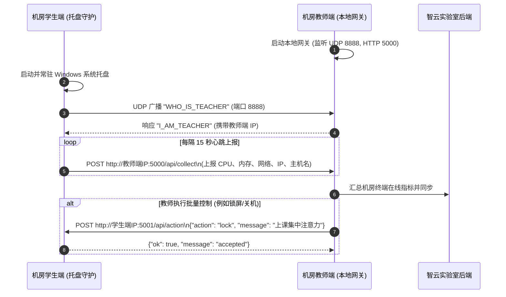
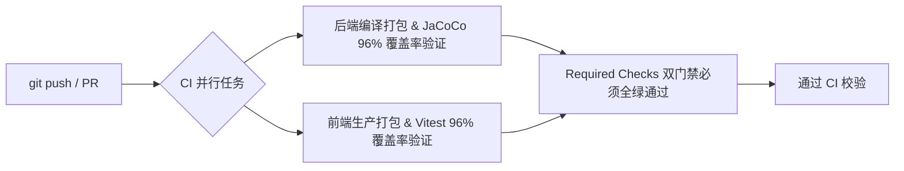

<div align="center">

  

  # 智云实验室 (Zhiyun Laboratory)

  <p><strong>基于数据驱动的智慧实验室全流程协同管控平台</strong></p>
  <p>连接空间资源、教学排课、环境准备、设备运维与物联感知，实现全生命周期业务闭环。</p>

  <p><em>数智协同，全域感知，运维如流。</em></p>

  <p>
    <b>中文</b> | <a href="#-zhiyun-laboratory-overview">English</a>
  </p>

  <p>
    <a href="https://github.com/Alexander-Noah/classjob/actions/workflows/ci.yml">
      
    </a>
    <a href="https://github.com/Alexander-Noah/classjob/actions/workflows/ci.yml">
      
    </a>
    <a href="https://github.com/Alexander-Noah/classjob">
      
    </a>
    <a href="https://spring.io/projects/spring-boot">
      
    </a>
    <a href="https://vuejs.org/">
      
    </a>
    <a href="https://tauri.app/">
      
    </a>
    <a href="https://www.mysql.com/">
      
    </a>
  </p>

</div>

---

## 目录

- [当前能力](#当前能力)
- [它如何工作](#它如何工作)
- [技术栈](#技术栈)
- [仓库结构](#仓库结构)
- [环境要求](#环境要求)
- [快速上手](#快速上手)
- [客户端如何连上本机 API](#客户端如何连上本机-api)
- [机房一仓双端与终端管控](#机房一仓双端与终端管控)
- [开启真实语音与 AI 智能体](#开启真实语音与-ai-智能体)
- [本机开发后端](#本机开发后端)
- [质量检查与代码规范](#质量检查与代码规范)
- [HTTP 与 WebSocket 通信](#http-与-websocket-通信)
- [环境变量与核心配置](#环境变量与核心配置)
- [云上部署与可观测性](#云上部署与可观测性)
- [CI 与自动化质量保障](#ci-与自动化质量保障)
- [相关入口与参考文档](#相关入口与参考文档)

---

## 当前能力

智云实验室针对高校与科研院所机房、实验室运维繁杂、软硬件脱节、排课协同低效等痛点，构建了涵盖**资源、排课、环境、报修、数据**五大维度的全闭环管控能力：

- 🏢 **基础资源全生命周期管控**
  - **空间与台账管理**：实验室容量、布局、责任人、开放状态多维归档。
  - **设备资产流转**：支持设备录入、批量 Excel 导入、资产码（二维码）生成打印、设备调拨与周期性盘点记录追溯。
  - **耗材库存预警**：出入库双向追踪，低库存自动标记与补给提醒。
- 📅 **教学预约与排课协同**
  - **课表智能采集导入**：内置 Python 爬虫与课表解析器，自动化同步教务排课数据。
  - **冲突检测与预约审批**：实验室空闲档期可视化呈现，支持教师/学生预约申请与多级审批流转。
  - **调课联动处理**：智能关联课程调整与实验场地重分配，避免教学冲突。
- 🧪 **实验环境与物联感知**
  - **课程环境预配置**：教师在线提报课程软件依赖与配置需求，管理员一键部署核验。
  - **环境模板库沉淀**：典型课程环境打包为模板，跨实验室与学期极速复用。
  - **IoT 物联感知控制**：联动智能灯光、空调温控、智能门禁、环境传感器与监控摄像头，支持一键场景切换。
- 🛠️ **故障报修与闭环运维**
  - **全链路工单流转**：异常一键上报 → 管理员智能派单 → 维修人员现场核验修复 → 闭环验收归档。
  - **动态通知公告**：系统重要事件、停电维护、预约结果实时消息下发。
- 🖥️ **一仓双端桌面机房监控（Tauri 2 + Rust）**
  - **教师端（控制网关）**：带界面本地值守，局域网 UDP 自动广播响应，集中监视学生机在线状态与性能指标，支持统一锁屏、消息广播、重启与关机控制。
  - **学生端（托盘守护）**：Windows 轻量级托盘程序，开机自启无感驻留，UDP 自动发现教师端，定时采集 CPU/内存/网络状态并静默上报。
- 🤖 **AI 助手与离线语音识别**
  - **通义千问企业 Agent**：集成 DashScope 大模型，提供实验室调度、报修指引与规则问答。
  - **Vosk 离线语音引擎**：内置轻量级中文声学模型，无需外网即可快速语音指令交互。
  - **WebSocket 全双工通信**：打字机流式回答，响应延迟低至毫秒级。
- 📊 **运营数据统计与指标分析**
  - 空间利用率、设备故障频次、耗材损耗率多维度 ECharts 图表透视，辅助管理决策。

---

## 它如何工作

智云实验室采用 **B/S 管理端平台 + C/S 桌面管控终端 + 物联感知网关 + 大模型决策引擎** 的一体化分层协同架构：

```mermaid
flowchart TD
    subgraph 接入层 [多端交互接入]
        WebClient["Web 管理工作台 (Vue 3 + Element Plus)"]
        TeacherClient["机房教师端 (Tauri 2 + Vue 3)"]
        StudentClient["机房学生端守护进程 (Tauri 2 / Rust)"]
    end

    subgraph 网关与应用服务 [业务中台 (Spring Boot 3)]
        APIGateway["RESTful API & JWT 安全过滤"]
        WSHandler["WebSocket 流式推送服务"]
        CoreService["核心业务域\n(资源 / 排课 / 预约 / 报修 / 耗材)"]
        AIEngine["AI 助手服务\n(通义千问 Agent + Vosk 语音)"]
    end

    subgraph 数据与感知层 [底层支撑]
        MySQL[(MySQL 8.0 核心业务库)]
        IoTGateway["IoT 硬件网关\n(灯光 / 空调 / 门禁 / 传感器)"]
        Prometheus["Prometheus + Grafana 监控体系"]
    end

    WebClient -->|HTTP / JSON| APIGateway
    WebClient <-->|WebSocket| WSHandler
    TeacherClient -->|HTTP 5000 状态上报| APIGateway
    StudentClient <-->|UDP 8888 广播发现 / HTTP 5001 指令控制| TeacherClient
    StudentClient -->|定时性能数据| TeacherClient
    APIGateway --> CoreService
    WSHandler <--> AIEngine
    CoreService --> MySQL
    CoreService --> IoTGateway
    APIGateway -.->|8081 Actuator 指标| Prometheus
```

### 业务闭环模型

```
[教学排课 / 课表同步] 
        ↓
[课程软件环境提报与确认] 
        ↓
[师生预约审批 / 场地分发] 
        ↓
[物联环境感知自动调节 / 桌面端开机上线] 
        ↓
[设备运行监测 / 故障报修流转] 
        ↓
[大数据分析利用率 / 智能辅助优化决策]
```

---

## 技术栈

| 领域 | 核心技术 / 框架 | 版本 / 说明 |
| :--- | :--- | :--- |
| **后端核心** | Spring Boot | `3.x` (MVC + 自动化配置) |
| **ORM / 数据存储** | MyBatis / HikariCP / MySQL | `MySQL 8.0+`，驼峰下划线智能映射 |
| **认证与安全** | JWT / BCrypt / Filter 过滤 | 无状态 Token 授权，接口细粒度鉴权与 XSS 防御 |
| **前端管理平台** | Vue 3 + Vite + Element Plus | Composition API、UnoCSS、响应式液态玻璃 UI |
| **数据可视化** | ECharts | 空间利用率、耗材消耗与设备生命周期统计 |
| **桌面客户端** | Tauri 2 + Rust + Naive UI | 一仓双端架构（教师控制端 + 学生端托盘守护） |
| **AI 与语音识别** | 通义千问 Agent + Vosk | DashScope 企业级大模型 + Vosk 离线轻量级中文语音模型 |
| **教务数据爬虫** | Python 3 + Requests + BeautifulSoup | 自动化课表拉取与入库工具 |
| **监控可观测性** | Prometheus + Grafana + Docker Compose | 独立 8081 管理端口，实时 JVM、HikariCP 与接口指标看板 |
| **质量门禁** | JaCoCo + Vitest + GitHub Actions | **96% 全量代码行覆盖率硬性门禁** |

---

## 仓库结构

```text
classjob/
├── .github/                     # GitHub Actions CI 工作流与测试汇总脚本
│   ├── workflows/ci.yml         # 前后端 96% 覆盖率验证门禁
│   └── scripts/coverage-summary.py
├── Backend/                     # 后端工程 (Spring Boot 3 + MyBatis)
│   ├── src/main/java/org/example/backend/
│   │   ├── config/              # Swagger、全局异常处理、IoT 配置等
│   │   ├── controller/          # 实验室、设备、预约、工单等 19+ 控制器
│   │   ├── entity/              # 数据库实体映射类
│   │   ├── mapper/              # MyBatis Mapper 接口
│   │   ├── security/            # JWT 服务、密码加盐与过滤器
│   │   ├── service/             # 业务服务层与实现
│   │   └── websocket/           # AI 助手 WebSocket 处理器
│   ├── src/main/resources/mapper/  # MyBatis SQL XML 映射文件
│   ├── pom.xml                  # Maven 依赖与 JaCoCo 插件配置
│   └── start-local.ps1          # 本地后端快速启动脚本
├── web/                         # 前端管理平台 (Vue 3 + Vite + Element Plus)
│   ├── src/
│   │   ├── api/                 # Axios 实例封装与通用模块服务
│   │   ├── components/          # 液态玻璃风格组件、通用业务表格/弹窗
│   │   ├── composables/         # 设备、实验室组合式逻辑 Hooks
│   │   ├── views/               # 工作台、实验室、设备、报修、AI助手等页面
│   │   └── utils/               # Excel 导入导出、二维码生成、XSS 清洗
│   ├── package.json             # 前端依赖配置
│   └── vite.config.js           # Vite 代理与构建配置
├── TvTa-ui-main/                # 桌面客户端工程 (Tauri 2 + Rust + Vue 3)
│   ├── src/                     # 教师端 UI 页面 (Naive UI)
│   ├── src-tauri/               # Rust 核心（教师端 UDP 网关 + 学生端后台托盘）
│   └── package.json             # 客户端打包与构建脚本
├── Python/                      # 教务课表爬虫与解析导入脚本
├── vosk-model-small-cn-0.22/    # Vosk 中文轻量级离线语音识别模型
├── monitoring/                  # Prometheus + Grafana 容器化监控编排
│   ├── compose.yaml             # Docker Compose 配置文件
│   └── prometheus/              # Prometheus 采集规则配置
├── docs/                        # 系统架构图、数据库 ER 图与设计文档
├── scripts/                     # ER 图与文档自动生成工具
└── 项目架构说明.md              # 详尽系统架构指南
```

---

## 环境要求

在开始部署或开发前，请确保本地已安装好以下基础运行环境：

| 工具 / 运行时 | 推荐版本 | 用途 |
| :--- | :--- | :--- |
| **JDK** | `Java 17` 或更高 (如 Temurin 17) | 后端 Spring Boot 运行与编译 |
| **Node.js** | `Node.js 18.x` ~ `24.x` | Web 前端与桌面客户端构建 |
| **包管理工具** | `npm 9+` 或 `pnpm 9+` | 前端依赖管理 |
| **MySQL** | `MySQL 8.0` 或更高版本 | 业务持久化数据库 |
| **Rust** *(可选)* | `Rust 1.75+` (带 Cargo) | 仅在重新编译 Tauri 桌面端时需要 |
| **Python** *(可选)* | `Python 3.10+` | 仅在运行课表抓取爬虫时需要 |
| **Docker** *(可选)* | Docker Desktop (支持 Compose v2) | 运行 Prometheus + Grafana 监控服务 |

---

## 快速上手

### 1. 克隆仓库

```bash
git clone https://github.com/Alexander-Noah/classjob.git
cd classjob
```

### 2. 数据库准备

1. 打开本地 MySQL 客户端，创建数据库 `smart_lab_basic`：
   ```sql
   CREATE DATABASE IF NOT EXISTS smart_lab_basic DEFAULT CHARACTER SET utf8mb4 COLLATE utf8mb4_unicode_ci;
   ```
2. 执行位于 `Backend` 或 `docs/` 下的初始化建表与数据脚本（自动建表并灌入演示数据）。

### 3. 启动后端服务 (Backend)

```powershell
cd Backend
# 方式 A：使用内置脚本启动
./start-local.ps1

# 方式 B：使用 Maven 命令行启动
mvn clean spring-boot:run
```

后端服务将在 `http://127.0.0.1:8080` 启动，健康检查与监控管理端口位于 `http://127.0.0.1:8081`。

### 4. 启动 Web 管理平台 (Web)

```bash
cd web
npm install
npm run dev
```

启动完成后，浏览器访问 `http://127.0.0.1:5173`。

### 5. 默认演示账号

系统预设了四种角色的典型用户以供快速体验：

| 角色类别 | 登录账号 | 默认密码 | 可操作核心模块 |
| :--- | :--- | :--- | :--- |
| **系统管理员** | `sysadmin` | `123456` | 全平台最高权限、用户管理、系统设置 |
| **实验室管理员** | `labadmin` | `123456` | 空间资产、设备调拨盘点、耗材、预约审批、环境维护 |
| **授课教师** | `teacher1` | `123456` | 课表查看、实验空间预约、课程环境提报、调课申请 |
| **维修人员** | `repair1` | `123456` | 故障工单接单、现场处理归档、维修记录上报 |

---

## 客户端如何连上本机 API

Web 管理前端通过内置的 Vite 反向代理平滑连通后端接口，桌面端通过局域网广播与直连 HTTP 进行双向通信。

### 1. Web 端连接后端

在开发环境中，`web/vite.config.js` 默认配置了 `/api` 代理规则：

```javascript
server: {
  port: 5173,
  proxy: {
    '/api': {
      target: process.env.VITE_API_PROXY_TARGET || 'http://127.0.0.1:8080',
      changeOrigin: true,
      rewrite: (path) => path.replace(/^\/api/, '')
    }
  }
}
```

- 若后端运行在其他主机或端口，仅需在 `web/.env.development` 中修改 `VITE_API_PROXY_TARGET=http://你的IP:8080`。
- 生产环境建议通过 Nginx 进行反向代理转发。

---

## 机房一仓双端与终端管控

针对实验室计算机机房批量运维需求，`TvTa-ui-main` 实现了极具特色的双端协同通信协议：



### 端口与通信协议

- **教师端（控制台）**：
  - `UDP 8888`：监听并响应局域网学生端的自动发现广播。
  - `HTTP 5000`：接收所有学生端主动上报的运行指标。
- **学生端（静默守护）**：
  - `HTTP 5001`：提供控制指令接口，支持 `refresh`（刷新）、`message`（弹窗提醒）、`lock`（锁屏）、`reboot`（重启）、`shutdown`（关机）。
- **运行方式**：
  - 启动教师端：`cd TvTa-ui-main && pnpm tauri dev`
  - 独立运行学生端：`TvTa-ui-main/src-tauri/target/release/zhiyun-student-client.exe`

---

## 开启真实语音与 AI 智能体

系统集成了 **Vosk 离线语音识别** 与 **通义千问大模型 Agent**：

### 1. 配置阿里通义千问 API Key

在 `Backend/src/main/resources/application.yaml` 或系统环境变量中配置 DashScope Key：

```yaml
smart-lab:
  ai:
    dashscope:
      api-key: ${DASHSCOPE_API_KEY:your_actual_api_key}
      model: qwen-plus
```

### 2. 离线中文语音识别 (Vosk)

项目根目录已集成轻量级中文声学模型 `vosk-model-small-cn-0.22/`：
- 后端启动时自动加载本地模型权重文件。
- 前端通过 Web Audio API 采集音频分片，经由 WebSocket 流式传送到后端 Vosk 引擎进行实时转文字，无需联网即可高精度识别指令。

### 3. WebSocket 交互地址

- 接口端点：`ws://127.0.0.1:8080/ws/ai-assistant`
- 数据格式：支持发送 JSON 文本消息或 PCM 音频流分片，服务端采用流式事件逐步推流返回。

---

## 本机开发后端

后端基于标准 DDD 与 MVC 分层设计，代码调用链清晰可循：

```text
HTTP Controller  -->  Service Interface  -->  ServiceImpl  -->  MyBatis Mapper (XML)  -->  MySQL
```

### 核心开发规范

1. **统一返回封装**：所有 Controller 接口必须返回 `Result<T>` 实体：
   - 成功：`return Result.success("操作成功", data);`
   - 失败：`return Result.error("业务异常信息");`
2. **字段自动映射**：开启了 `map-underscore-to-camel-case: true`，数据库 `device_code` 会自动对应实体类中的 `deviceCode`。
3. **事务强一致性**：涉及资产流转、出入库、审批多表更新的操作，在 Service 方法上标注 `@Transactional`。
4. **日志追踪**：内置 `RequestLoggingFilter` 统一生成 `requestId`，自动记录每笔请求的方法、URI、处理耗时与异常堆栈。

---

## 质量检查与代码规范

本项目在持续集成中设定了极高标准的质量门禁（**全量代码行覆盖率要求达到 96% 以上**）：

### 1. 后端测试与覆盖率检查

```powershell
cd Backend
# 执行单元测试、集成测试并生成 JaCoCo 覆盖率报告
mvn -Pcoverage verify
```

测试报告生成路径：`Backend/target/site/jacoco/index.html`。

### 2. 前端测试与覆盖率检查

```bash
cd web
# 运行生产构建
npm run build

# 执行 Vitest 测试套件并验证 96% 覆盖率门禁
npm run test:coverage
```

测试覆盖率产物：`web/coverage/`。

### 3. 安全防御与校验

- **XSS 防御**：富文本与动态内容通过 DOMPurify 清洗，严格隔离恶意脚本。
- **输入校验**：前端统一封装 `requestValidation.js`，后端配置全局验证拦截，杜绝 SQL 注入与越权访问。

---

## HTTP 与 WebSocket 通信

### HTTP RESTful 规范

- 采用标准 HTTP 谓词：`GET`（查询）、`POST`（创建）、`PUT`（更新）、`DELETE`（删除）。
- 鉴权机制：除登录与公开监控端口外，所有请求头需携带 Bearer Token：
  ```http
  Authorization: Bearer <your_jwt_token>
  ```
- 响应体格式：
  ```json
  {
    "code": 200,
    "message": "list devices success",
    "data": [ ... ]
  }
  ```

### WebSocket 实时通道

- `/ws/ai-assistant`：AI 智能体问答交互流式双向传输。

---

## 环境变量与核心配置

可通过系统环境变量或修改各模块配置文件进行自定义：

| 模块 | 变量名 | 默认值 | 作用说明 |
| :--- | :--- | :--- | :--- |
| **Backend** | `SMART_LAB_DB_URL` | `jdbc:mysql://localhost:3306/smart_lab_basic` | MySQL 连接串 |
| **Backend** | `SMART_LAB_DB_USERNAME` | `root` | 数据库用户名 |
| **Backend** | `SMART_LAB_DB_PASSWORD` | *(空)* | 数据库密码 |
| **Backend** | `SMART_LAB_JWT_SECRET` | *(内部默认密钥)* | JWT 签名密钥（生产环境请务必修改） |
| **Backend** | `DASHSCOPE_API_KEY` | *(空)* | 阿里通义千问 API 密钥 |
| **Web** | `VITE_API_MODE` | `server` | 接口模式（`server` 真实联调 / `mock` 假数据） |
| **Web** | `VITE_API_PROXY_TARGET` | `http://127.0.0.1:8080` | 开发环境后端代理目标地址 |
| **Monitoring** | `GRAFANA_ADMIN_PASSWORD` | *(需配置)* | Grafana 监控后台管理员密码 |

---

## 云上部署与可观测性

### 1. 后端与 Web 端生产打包

```bash
# 1. 打包后端 Jar
cd Backend && mvn clean package -DskipTests

# 2. 构建前端静态资源
cd ../web && npm run build
```

前端生成的 `dist/` 目录配合 Nginx 托管，示例配置：

```nginx
server {
    listen 80;
    server_name smartlab.your-school.edu.cn;

    location / {
        root /var/www/smartlab/dist;
        try_files $uri $uri/ /index.html;
    }

    location /api/ {
        proxy_pass http://127.0.0.1:8080/;
        proxy_set_header Host $host;
        proxy_set_header X-Real-IP $remote_addr;
    }

    location /ws/ {
        proxy_pass http://127.0.0.1:8080/;
        proxy_http_version 1.1;
        proxy_set_header Upgrade $http_upgrade;
        proxy_set_header Connection "Upgrade";
    }
}
```

### 2. Prometheus + Grafana 容器化监控

项目自带开箱即用的监控配置（详见 `monitoring/README.md`）：

```powershell
cd monitoring
Copy-Item .env.example .env
# 启动监控容器组
docker compose up -d
```

- 后端核心指标暴露于独立管理端口 `8081`（`/actuator/prometheus`）。
- 访问 Grafana：`http://localhost:3000`（账号：`admin`），默认内置 `zhiyun-backend` 仪表盘，实时观测 **QPS、P95 响应时延、5xx 错误率、JVM 堆内存、线程池与 HikariCP 数据库连接池活跃度**。

---

## CI 与自动化质量保障

项目采用 GitHub Actions（见 `.github/workflows/ci.yml`）实现自动化质量守护：



- **容器级服务集成**：后端 CI 自动启动临时 MySQL 8.4 容器执行真实数据流集成测试。
- **全量无缝验证**：任一模块测试失败或覆盖率未达标将直接中断合并流程，确保主干分支代码健壮可靠。

---

## 相关入口与参考文档

- 🌐 **Web 管理平台开发入口**：`http://localhost:5173`
- 📡 **后端业务 API 地址**：`http://localhost:8080`
- 📑 **Swagger / OpenAPI 接口文档**：`http://localhost:8080/swagger-ui.html`
- 📈 **Prometheus 采集看板**：`http://localhost:9090`
- 📊 **Grafana 综合监控面板**：`http://localhost:3000/d/zhiyun-backend`
- 📖 **架构设计详述文档**：[项目架构说明.md](项目架构说明.md)
- 🎨 **界面与交互设计规范**：[DESIGN.md](DESIGN.md)
- 📦 **产品定义与用户定位**：[PRODUCT.md](PRODUCT.md)
- 🗂️ **快速文件检索与资产指南**：[文件索引-快速查找指南.md](文件索引-快速查找指南.md)

---

## 🌐 Zhiyun Laboratory Overview

**Zhiyun Laboratory** is a modern, data-driven collaborative operations platform tailored for university and research laboratories. It unifies space resources, curriculum timetables, course software environments, device lifecycle operations, and IoT environmental sensing into a unified closed-loop platform.

### Key Highlights
- **Full Lifecycle Asset Management**: Equipment inventory, transfer tracking, asset QR code generation, and consumable stock threshold alarms.
- **Academic Timetable & Booking Synergy**: Python-based automatic timetable scraper and multi-level lab reservation workflow.
- **Dual-Client Desktop Monitoring (Tauri 2 + Rust)**: Teacher console for batch control (broadcast notifications, lock screen, shutdown) & Student background system-tray daemon with automatic LAN UDP discovery.
- **AI Agent & Offline Speech Recognition**: Integrated Alibaba DashScope LLM agent and offline Vosk Chinese speech recognition via real-time WebSocket.
- **High-Standard CI/CD Guardrails**: Enforcing strict 96% line coverage on both backend (Spring Boot + JaCoCo) and frontend (Vue 3 + Vitest) alongside Prometheus/Grafana observability.

---

<div align="center">
  <sub>智云实验室 (Zhiyun Laboratory) &copy; 2026. Made with ❤️ for Smart Campus & Laboratory Management.</sub>
</div>

